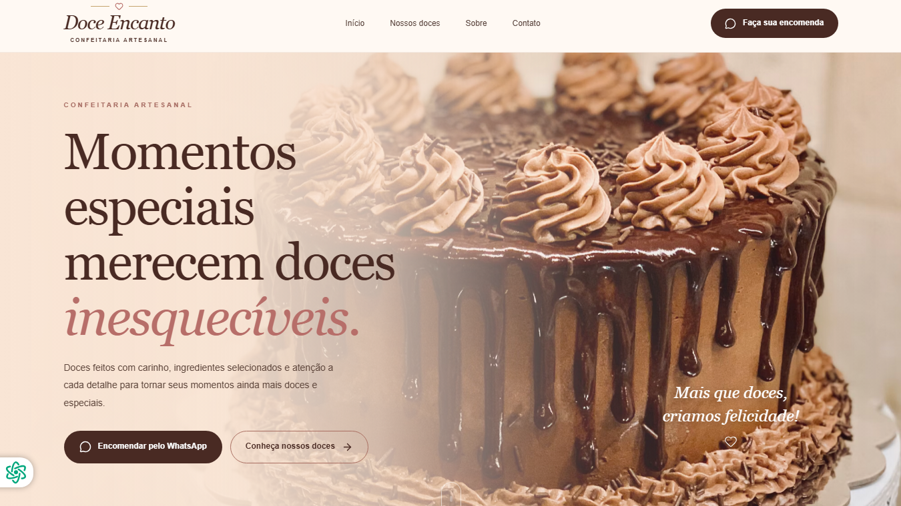

# 🍰 Doce Encanto

### Landing Page Demonstrativa para Confeitaria Artesanal

**Projeto desenvolvido por AW TECHNOLOGY**

O Doce Encanto é uma landing page demonstrativa criada para apresentar uma confeitaria artesanal, destacando seus produtos, sua identidade visual e os canais de contato para encomendas.

O projeto possui um design delicado e elegante, com cores suaves e elementos visuais que valorizam os produtos e proporcionam uma experiência agradável aos visitantes.

## ✨ Funcionalidades

- 🏠 Página inicial com apresentação da marca.
- 🧁 Catálogo com 12 produtos de confeitaria.
- 🖼️ Galeria de Delícias com 6 imagens.
- 🎨 Identidade visual com cores e elementos que remetem à confeitaria artesanal.
- 📱 Layout responsivo para diferentes tamanhos de tela.
- 💬 Seções destinadas ao contato e às encomendas.
- ℹ️ Seção de apresentação da confeitaria.
- 🦶 Rodapé com informações da marca e identificação do desenvolvedor.

## 🖥️ Demonstração

**Acesse a landing page publicada:**

🌐 https://doceencanto-oficial.vercel.app/

### Página inicial



## 🛠️ Tecnologias utilizadas

- **Next.js** — Framework para desenvolvimento web.
- **React** — Construção da interface.
- **TypeScript** — Tipagem estática e maior segurança no desenvolvimento.
- **Tailwind CSS** — Estilização da aplicação.
- **Lucide React** — Biblioteca de ícones.

## 🍬 Produtos apresentados

O catálogo contempla diferentes opções de doces e sobremesas:

- Bolos artesanais
- Brigadeiros gourmet
- Trufas artesanais
- Cupcakes personalizados
- Brownies artesanais
- Bolos de pote
- Doces finos
- Caixas de doces para presente
- Cookies artesanais
- Mini bolos decorados
- Tortinhas artesanais
- Pães de mel recheados

## 🖼️ Galeria de Delícias

A galeria apresenta uma seleção de seis imagens para valorizar a identidade visual da confeitaria e despertar o interesse dos visitantes pelos produtos.

## 🚀 Como executar o projeto localmente

### Pré-requisitos

- Node.js instalado.
- npm instalado.
- Git instalado.

### 1. Clone o repositório

```bash
git clone https://github.com/awaldige/doce-encanto.git
```

### 2. Entre na pasta do projeto

```bash
cd doce-encanto
```

### 3. Instale as dependências

```bash
npm install
```

### 4. Execute o ambiente de desenvolvimento

```bash
npm run dev
```

### 5. Acesse a aplicação

Abra o navegador e acesse:

```text
http://localhost:3000
```

### 6. Gere a versão de produção

Para verificar e compilar a aplicação para produção, execute:

```bash
npm run build
```

## 📂 Estrutura do projeto

```text
doce-encanto/
├── public/
│   └── imagens/
├── src/
│   └── app/
│       ├── globals.css
│       ├── layout.tsx
│       └── page.tsx
├── package.json
├── package-lock.json
├── tsconfig.json
└── README.md
```

## 🎯 Objetivo do projeto

Demonstrar a criação de uma landing page moderna e responsiva para uma confeitaria artesanal, com foco na apresentação de produtos, na identidade visual e na experiência do usuário.

O projeto também demonstra a aplicação prática de tecnologias modernas de desenvolvimento web em uma solução que pode servir como referência para negócios que desejam fortalecer sua presença digital.

## ⚠️ Observação

Este é um projeto demonstrativo desenvolvido para fins de portfólio. As informações, os produtos e os contatos devem ser personalizados conforme as necessidades de uma confeitaria real.

## 👨‍💻 Desenvolvedor

**AW TECHNOLOGY**

Desenvolvimento de sites, landing pages e sistemas web personalizados.

---

© 2026 Doce Encanto — Projeto demonstrativo desenvolvido por AW TECHNOLOGY.